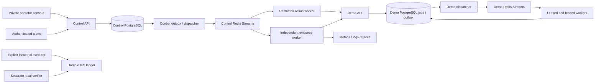

# System architecture

OpsProof demonstrates durable job processing, controlled reliability trials and
operator-governed recovery with independent evidence. It is a bounded engineering
demonstration with explicit local and temporary-cloud profiles.

The demo API creates jobs and outbox entries in one transaction. Delivery is at
least once: publishing or acknowledgment can be interrupted. Database leases,
fencing and terminal-state checks prevent stale workers from authoring duplicate
durable completion. Arbitrary external side effects are not claimed exactly once.

The control API has no Kubernetes mutation credential. Separate action/evidence
processes perform bounded roles. Recovery requires fresh eligible deterministic
evidence and explicit approval. Model output never grants operation authority.
Sessions are revocable, stored as hashes and protected by CSRF for mutations.

The trial coordinator records intent and expiry; it is not a general fault
injector. Host-side execution requires explicit local scope, target ownership,
resource headroom and cleanup agreement. Separate verification binds proof to
dispatch/observer/target identities and exact jobs. Cleanup and fault-hypothesis
results are distinct; executor assertions cannot prove either. The machine and
database administrator remain trusted.

Runtime investigation and the broader reliability benchmark have different
schemas/scopes. An offline score does not qualify another adapter. Runtime AI
remains disabled pending its actual qualification gate; failures are retained.

Compose/local Kubernetes preserve the controlled demo and recovery profiles.
Temporary EKS uses read-only observation, private operator access, TLS/authenticated
queues, separate DB roles and managed control PostgreSQL. The isolated public
edge cannot proxy the operator API. One NAT and single-replica demo/telemetry
dependencies are deliberate limitations, not production HA claims.

Source, locks and migrations belong in Git. Large tools/caches use user-local
storage; active private output is ignored. Historical proof retains immutable
bytes and explicit locators. Dated results apply to their recorded source.

See [repository structure](../engineering/repository-structure.md),
[local operation](../operations/local-runbook.md) and
[cloud readiness](../cloud/readiness.md) for separate verification gates.
