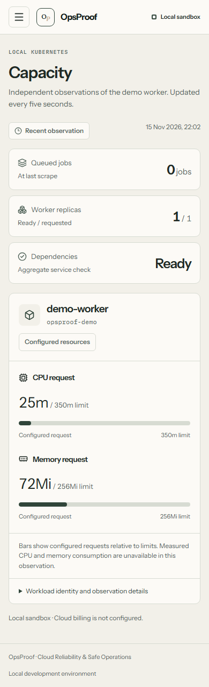

# Engineering verification

## Local results and screenshots

The benchmark ran on local Kubernetes with three accepted trials per mode. Each
trial used 60 jobs configured for two seconds of work, the same application
revision, and 120 seconds of background HTTP load. The generator targeted 80
requests per second and served roughly 48–63 requests per second across the
accepted trials. The comparison uses the median of each mode's three per-run
job p95 values. API HPA scaled the API, while KEDA scaled workers using Redis
Streams lag and pending entries.

| Mode | Job p95 for the three trials (s) | Median job p95 (s) | Median throughput (jobs/s) |
| --- | --- | ---: | ---: |
| Fixed replicas | 101.500207, 101.311598, 101.433886 | 101.433886 | 0.497703 |
| API HPA | 102.265894, 101.623977, 102.359241 | 102.265894 | 0.497389 |
| KEDA worker scaling | 34.481898, 35.423098, 37.208533 | 35.423098 | 1.224233 |

- **Job p95 reduction:** `(101.433886 − 35.423098) ÷ 101.433886 × 100 = 65.08%`.
- **Job p95 time saved:** `101.433886 − 35.423098 = 66.01 s`.
- **Throughput:** `1.224233 ÷ 0.497703 = 2.46×` the fixed-replica baseline.

The eligible runs completed all 60 exact jobs once per trial. Two excluded
attempts remain in the private run history. One was indeterminate before
restoration finished and one recorded an HTTP failure. The measurements describe
this controlled local comparison. Actual background rates varied, and AWS and
production performance are pending. The nine original receipts and their hashes
are preserved in the private verification index. The [analysis code](../../scripts/reliability/analyze_capacity.py)
reproduces the medians and checks that the workloads and revisions match.

A separate k6 run reconciled **60 unique submissions and 60 durable completions**.
Six local scenarios produced independent fault and cleanup evidence, including
database connectivity, downstream timeout, canary abort with stable traffic
restored, worker interruption, queue saturation and stale observations. The [sanitized scenario records](../public/cases.json)
contain the tested source identities and independent receipt digests.

| Capacity observations | Recovery approval and independently verified outcome |
| --- | --- |
| [](../public/screenshots/local-capacity.png) | [Open the local recovery screenshot](../public/screenshots/local-recovery.png) |

These are original browser captures of the OpsProof UI served by the local cluster.
The deployment receipt records Argo CD `Synced` and `Healthy`, **34 served assets**
matched by hash, and **20 passing view and viewport checks**. The capacity image
shows configured requests and limits. The benchmark table supplies the measured
performance evidence. A separate shutdown drill recorded **eight exact jobs**
completing once and verification resuming after a restart.

## Verification history

The latest local validation is the [repository finalization follow-up](#repository-finalization-follow-up--24-november-2026). Earlier sections retain their dated results.

Reviewed 21 November 2026. The repository cleanup and local verification work is
complete for the checks recorded below. This is not cloud acceptance or release
approval. The Python base-image findings have been remediated and all four final
images scanned clean. At this 21 November baseline, runtime AI was disabled and
unqualified. The subsequent 24 November NVIDIA development qualification passed
all 42 cases; see [the current decision](advisory-evaluation.md). Runtime AI stays
disabled. No real AWS resource, Terraform apply, model request, Git push or
publication occurred during the earlier baseline finalization.

## Pre-cloud release closeout — 24 November 2026

The final source was reproduced in a disposable source-only checkout with fresh
locked Python and npm installs. No owner environment, previous virtual
environment, node_modules or private historical runtime evidence was copied.
The complete source gate passed 550 Python/tooling tests and 21 subtests, 39 demo
tests, 46 web tests, lint/format, production web build, 25 local Helm profiles,
cloud/controller/shared telemetry renders, 215 Kubernetes objects against 51
schemas, workflow contracts, source secret scanning and whitespace checks.
The 36 SQL-only cases skipped by this source gate were executed separately:
31 actual PostgreSQL integrations and five TLS/role bootstrap tests passed.

Two added SQL integrations cover authenticated AI queueing, the real worker,
restricted-role durable results, duplicate-request behavior and rejection of
policy-mismatched model output. Only the provider transport is intercepted;
these tests make no model calls and do not enable runtime AI. The previously
reviewed live NVIDIA 42-case pass remains unchanged and was not repeated.

The five source-identified local release images built successfully. The four
application images passed network-isolated nonroot/read-only smoke tests, and
both Python artifacts passed actual TLS dependency/job/worker/shutdown checks.
The complete application inventories found zero vulnerabilities at every
reported severity; all six telemetry artifacts passed the unchanged strict
HIGH/CRITICAL gate, including unfixed findings and the documented exact-source
Grafana policy. Complete reports and SBOMs remain private. These dated results
must be refreshed for the separately approved published release.

Real disposable checks also passed PostgreSQL migration preservation, the
production browser/API at five viewport widths with 20 screenshots and
accessibility checks, both Redis TLS/auth profiles, the loopback-only AWS
Emulator contracts, and the monitoring restart/log/trace/Grafana/alert/watch
pipeline. All three Terraform roots passed formatting, backend-disabled init,
validation and 11 native mock tests. Ten workflows passed actionlint.

Private proof is under `.runtime/verification/release/`; the final receipt binds
the source checkpoint, exact image identities, commands, prior evidence and
cleanup. The initial telemetry attempt rejected a mutable fixture tag before
starting; the exact-ID run passed. Initial temporary-checkout cleanup encountered
read-only generated Git objects; owned cleanup was completed and the original
failure log preserved. Neither failure was relabeled as a successful command.

This is local pre-cloud verification. No Kubernetes cluster was started,
provider request made, AWS resource provisioned, Terraform apply executed,
Git push/merge performed or image published. Runtime AI remains disabled.
Hosted CI/publication, account-specific quota/version/cost checks, owner-reviewed
saved plans, real AWS acceptance, screenshots and complete teardown remain
separate deployment-session gates.

## What changed and why

- Fixed hosted workflow inputs and replaced cloud unittest discovery with pytest,
  so 28 previously omitted function tests are collected. Static input/discovery
  guards now complement actionlint and immutable Action pins.
- Grouped Compose helpers, removed direct sibling-import assumptions and kept
  module entry points. Tests and maintained documentation use responsibility
  names. Historical records, migration/SQL identities, API/settings contracts
  and frozen benchmark bytes retain their original identities.
- Separated external tools/caches, per-root Terraform data, private historical
  evidence and current verification output. Recorded archive hashes and verified raw-proof manifests;
  preserved credentials, kubeconfigs, all protected image exports and raw trials.
  Removed only confirmed regenerable copies/caches after fresh locked installs.
- Replaced the web template README, documented the actual architecture and
  artifact lifecycle, corrected links/status/comments, and kept the approved UI
  and original palette. No product framework, service or architecture was added.
- Pinned the uv image by verified digest, restricted Docker build inputs, fixed
  nginx libxml2 and monthly update coverage for every Docker context. Release
  builds refresh package layers; complete vulnerability reports are retained and
  HIGH/CRITICAL publication failures include unfixed findings.
- Added exact locked-controller custom-resource and official Kubernetes CRD
  definition validation. Removed missing-schema exclusions from this new gate.
- Fixed Windows test paths exposed by the isolated checkout. Disposable pytest
  state uses a short temporary directory and is cleaned automatically.
- Preserved the historical illustrative cost evidence privately, corrected a
  stale claim about local scaling trials and made missing fresh prices fail
  clearly. No cost quote was refreshed or spending approved.

## Executed verification

| Check | Actual result | Scope/limit |
|---|---|---|
| Full source gate in isolated Git checkout | Passed | 400+ Python/tooling tests and 21 subtests; 32 SQL tests skipped here and executed separately below |
| Demo workload | 33 tests passed | Locked fresh dependencies |
| Web console | 46 component tests, lint and production build passed | Original UI source/palette retained |
| Actual disposable PostgreSQL | 27 integration tests plus five role/TLS bootstrap tests passed | Fresh-checkout dependencies; legacy rows preserved; owned container removed |
| Production browser/API | Passed at five widths; 20 screenshots | Real restricted SQL/API; accessibility checks; fixture observations, not a live cluster |
| Redis | Both namespace profiles passed TLS/auth/queue/drain and negative probes | Real rendered server command; temporary containers/keys removed |
| Terraform | All three roots passed fmt/init/validate and 11 mock tests | Backend disabled, no real AWS endpoints/apply; shared verified provider |
| Helm | 25 local profiles plus 11 cloud/controller profiles passed | Rendering/semantic contracts, not runtime acceptance |
| Cloud schemas | All 188 objects passed against 51 schemas, including 46 CRD definitions | Wrong custom field type rejected; CEL/admission/runtime remain live checks |
| Workflow checks | Ten workflows passed actionlint, SHA pins and input/discovery contracts | Hosted execution not yet performed |
| Source dependency/IaC scan | No HIGH/CRITICAL findings | Actual native Trivy scan; npm clean install also reported zero vulnerabilities |
| Secrets | Current source and earlier all-history scans passed | Private ignored credentials deliberately excluded |
| Four final images | Build, nonroot/read-only smoke, export-integrity scan and CycloneDX SBOM passed | Local IDs recorded; no registry publication or cloud deployment |
| Final nginx vulnerability scan | Zero findings in web and edge images | libxml2 2.13.9-r3 floor, signed official mirror packages |
| Final Python vulnerability scan | Zero findings at every reported severity in both images; all eleven original HIGH CVEs absent | Signed Wolfi runtime packages; no exception/blanket ignore; repeat scans at release |
| Final Python artifact compatibility | Both images passed against fresh TLS PostgreSQL/Redis; eight service roles exited zero | Real job completion, restricted SQL role/login, negative TLS/auth, standard library and OTLP; SQLite 3.54.1 independently checked |
| Evidence retention | Six public-case private lineage bindings and 5,961 original handover artifact hashes passed | Proves preserved bytes/recorded status, not renewed incident execution |
| Preservation | .env, two kubeconfigs and webhook token matched checkpoint hashes | No credential values logged or overwritten |

The Python runtime remediation follow-up reran the full source gate: 409
Python/tooling tests plus 21 subtests, 33 demo tests and 46 web tests passed,
along with lint/format, production build, Helm/schema and workflow checks.
The 32 SQL-only tests remain outside that source gate; the earlier full SQL
baseline above and the new real artifact/TLS checks are separate evidence.
Native source vulnerability/IaC scanning found no HIGH/CRITICAL issues, actionlint
passed and the source secret scan was clean. A Docker-unavailable negative run
also failed closed and removed its generated private keys. Hosted execution of
the new artifact gate remains pending.

The actual maintained commands were run from the repository root, also from an
isolated clone with initially empty Python/npm dependency caches:

```text
uv sync --project apps/control-plane --locked
uv sync --project apps/demo-workload --locked
npm --prefix apps/web ci
uv run --project apps/control-plane --locked --with PyYAML==6.0.3 python -m scripts.reliability.validate_source
uv run --project apps/control-plane --locked python -m scripts.cloud.validate_infrastructure
uv run --project apps/control-plane --locked python -m scripts.reliability.validate_postgres --cloud --cloud-browser
uv run --project apps/control-plane --locked --with PyYAML==6.0.3 python -m scripts.cloud.validate_redis --execute
uv run --project apps/control-plane --locked python -m scripts.reliability.build_images_local
uv run --project apps/control-plane --locked python -m scripts.reliability.smoke_images
uv run --project apps/control-plane --locked python -m scripts.reliability.validate_python_image --component demo --image opsproof-demo:src-c8e974484ca9df49
uv run --project apps/control-plane --locked python -m scripts.reliability.validate_python_image --component control --image opsproof-control:src-d150747af6bf73b3
```

Expanded command arrays, exit codes, source identities, complete scanner output,
SBOMs, screenshots, failed attempts and private retention inventories are retained
with the execution audit. Native Trivy scanned hash-verified exports after Docker
shutdown to satisfy its unchanged 2 GiB free-memory gate. Public scanner downloads
timed out in the isolated bootstrap; two explicitly SHA256-verified public tool
archives were then seeded. No application runtime data, keys or old installed
application dependencies were copied into that checkout. This qualifies the
application reproduction; it is not a claim that every public download succeeded.

The regional Alpine CDN returned incomplete indexes; the successfully tested
[official HTTPS mirror](https://mirrors.alpinelinux.org/) resolved the rebuild.
Signature checks stayed enabled. Initial schema lookup, secret-scan false-positive
for a public checksum variable and Windows path failures were corrected before
the passing runs. Complete failure logs were preserved rather than rewritten.

## Observability hardening

The later observability hardening added compatible outbox-context migrations,
durable-state age/freshness metrics, actionable service/meta alerts, a bounded
persistent Collector queue, correlated logs/traces and measured-resource panels.
The four final application artifacts were rescanned with zero findings. The six
telemetry artifacts passed the strict HIGH/CRITICAL policy with complete supported
inventories and exact fixed-source proof where necessary; see the container
security policy for the raw Grafana mappings and remaining lower-severity results.

Actual disposable PostgreSQL acceptance now includes 29 integration tests and
five TLS/role bootstrap tests. The monitoring pipeline passed persistent restart,
real log/trace retrieval, authenticated Grafana queries, receiver-failure recovery
and firing/resolved notifications. An independent foreground watch detected
Prometheus and Alertmanager outages. Every fixture service exited zero.

The isolated Kubernetes test passed ready/unready Pod discovery, missing-target
alert firing, kubelet/cAdvisor TLS, measured container memory and explicit
positive/negative subresource authorization checks. The original cluster and
default kubeconfig were preserved. Local-path PVC capacity was unavailable;
unknown capacity is never interpreted as free space. Cloud EBS metrics, CNI
enforcement, hosted CI and approved publication are separate owner gates.

The local image importer now verifies the Docker OCI index, selected platform
manifest and CRI configuration identity separately. This avoids trusting a
successful k3d import exit or confusing different digest types. Failed fixture
attempts were retained as failures and their clusters were removed.

## Earlier pre-cloud evidence

The November 17 rehearsal was recorded against base `5dddbf6` and checkpoint
`b97302a`. The subsequent checks on this page supersede its working status and
image security findings. Earlier run-specific receipts are retained privately
under `.runtime/verification/cloud/` or the preserved runtime archive.

| Earlier check | Recorded receipt relative to that runtime directory |
| --- | --- |
| Terraform mock validation | `terraform/result.json` |
| Disposable SQL and browser | `postgres/` (exact result indexed in the private review) |
| Redis TLS and authentication | `redis/` |
| Emulator rehearsal | `emulator/run-8c682ff080704a839a992d32bc5472f4/result.json` |
| Rendered cloud capacity worksheet | `capacity.json` |
| Sanitized trial lineage and render | `public-lineage.json` and `public/` |

The full review, including corrected integration failures and earlier schema
coverage limits, is in the private documentation archive. The capacity worksheet
excluded node reservations and actual usage. Use the owner preflight and measured
allocatable capacity for deployment decisions. See
[retention and archive locations](repository-structure.md#generated-files-and-retention).

## Storage and history

The original reconciled inventory found 59,533 files and 7,385,786,993 logical
bytes, not 7 GB of source. Git tracked only about 2.4 MB. After cleanup the checkout
is below 0.6 GB; the apps tree is about 418 MB, mostly normal installed dependencies.
Exact final counts/classification and two-view coverage are in the private audit.

Moving evidence/caches out reduces checkout size, not necessarily disk usage.
Hash-verified provider deduplication plus the exact obsolete provider removal
eliminated about 2.47 GB of redundant provider payload; separate deletion receipts
identify regenerable dependency/cache removal. Current app environments remain.
Source/locks and unique evidence were not deleted. Older render/debug iterations
are privately archived, with the current passing schema/input pair retained.

Both purposeful branches and valuable history remain; main was not changed.
The public guide summarizes results and links the reviewed screenshots. Original
reports and compatibility identifiers are preserved. See
[structure and retention](repository-structure.md).

## Work that remains outside this verified baseline

1. The later NVIDIA qualification passed all 42 development cases, including
   ten runtime cause/action cases. Runtime enablement remains a separate operator
   decision, and deployed artifacts must contain the qualified source. Existing
   model calls must not be repeated solely to regenerate proof. Earlier failed
   provider evaluations remain historical; deterministic operations work with AI off.
2. Owner review/merge, hosted CI, approved image publication and actual registry
   digest/attestation verification remain pending. Local checks cannot prove them.
3. Owner account/profile, regional versions/quotas, fresh prices and saved-plan
   review must precede any apply. No account-specific checks were invented.
4. Real EKS/RDS/ALB/IAM/network/storage acceptance, cloud screenshots, teardown
   and settled billing checks necessarily follow the owner deployment window.

The six fault demonstrations and nine accepted scaling trials remain historical
local evidence. They were not rerun during this cleanup; Kubernetes stayed off.
Docker was used only for bounded local integrations/builds and stopped afterward.
See [container security](container-security.md), [AI decision](advisory-evaluation.md)
and the [owner deployment guide](../cloud/owner-deployment-session.md).


## Repository finalization follow-up — 24 November 2026

The approved static-audit corrections are implemented. Replica-aware investigation
collection requires matching unique scrape targets and healthy recent samples from
all returned replicas. Alert ingestion serializes first delivery, orders occurrences
by source time and retains receipt times separately. Runtime AI ownership is held
across the durable claim and provider response; abandoned unknown work is never
retried. Compose defaults, IPv4-only Terraform validation and environment labels
now match the maintained implementation. Runtime AI remains disabled.

Maintained runbooks now describe current behavior. Dated advisory/trial narratives
were consolidated into existing history documentation; frozen fixtures, failed
answers, original proof and compatibility identities were preserved. No framework,
service, deployment architecture or vulnerability waiver was added.

| Executed check | Result and scope |
|---|---|
| Final isolated source-only checkout | Fresh locked Python/npm installs; 565 backend/tooling tests and 21 subtests, 39 demo tests, 47 web tests passed |
| Real PostgreSQL | All 46 SQL-only cases skipped above passed separately: 41 integration/concurrency/ownership tests and five role/TLS tests; legacy rows preserved |
| Production browser/API | Passed using current built assets, real restricted SQL/API and synthetic cloud observations; 22 screenshots, five card widths and desktop/mobile investigation checks; accessibility checks passed |
| Terraform | Three backend-disabled roots passed formatting/init/validation and 14 native mock tests; no AWS endpoints or apply |
| Charts and schemas | 25 local profiles plus cloud/controller/telemetry profiles; 215 objects and 51 schemas; invalid custom field rejected |
| Workflows | Ten workflows passed actionlint, source-reference/input and pin checks; hosted execution remains pending |
| Current local images | Five source-identified images built; four application images passed nonroot/read-only/network-isolated smoke checks |
| Security | Four application inventories/SBOMs report zero vulnerabilities; six telemetry images pass the unchanged strict HIGH/CRITICAL gate with existing fixed-source proof; source vulnerability/IaC and source secret gates passed |
| Documentation | Relative file links checked; no missing targets after reconciliation; syntax, script references and whitespace checked |
| Preservation and cleanup | Protected credentials/configuration, palette, benchmark fixtures and model contract hashes unchanged; fresh checkouts, SQL fixtures and test servers removed; original cluster stayed stopped; Docker stopped |

The demo tests emitted one upstream TestClient/httpx deprecation warning; tests
passed. This follow-up does not change dependency policy solely to silence it.
Earlier targeted formatting checks needed correction, and the first browser run
preceded the current main-checkout UI build. Their receipts were retained; the
final current-asset browser run and final source gate passed. The final SQL
suite uses a real connection pool so closing a test connection cannot conceal a
leaked session lock. Source/receipt timestamp assertions passed as well.

Proof and exact command arrays are private under
`.runtime/verification/repository-finalization/20261124/`; SQL/browser proofs are
linked by `database-proof.json`. The clean-checkout manifest records tested source
hashes. This verification narrative and final status links were updated afterward;
final static checks bind those documentation-only differences to the receipt.
Local images carry the current parent commit plus dirty-source/content identities;
publication must rebuild the reviewed committed release rather than relabel them.

Commands executed included the following from the repository root (the source
commands also ran in an isolated checkout with initially empty dependency caches):

```text
uv sync --project apps/control-plane --locked
uv sync --project apps/demo-workload --locked
npm.cmd --prefix apps/web ci
uv run --project apps/control-plane --locked --with PyYAML==6.0.3 python -m scripts.reliability.validate_source
uv run --project apps/control-plane --locked python -m scripts.cloud.validate_infrastructure
npm.cmd --prefix apps/web run build
uv run --project apps/control-plane --locked python -m scripts.reliability.validate_postgres --cloud --cloud-browser
uv run --project apps/control-plane --locked python -m scripts.reliability.build_images_local
uv run --project apps/control-plane --locked python -m scripts.reliability.smoke_images
```

The checksum-verified Trivy 0.76.2 scanner checked full application inventories and
SBOMs, source vulnerabilities/IaC and the unchanged telemetry policy; actionlint
1.7.12 checked the workflows. Expanded arguments, image IDs, raw reports, gate
results, preservation and shutdown receipts are retained privately. No provider
request, Kubernetes startup, AWS provisioning, Terraform apply, registry/website
publication, Git commit/merge or push occurred. Review/commit, hosted CI, approved
release publication, account-specific preflight and real cloud acceptance remain
separate owner gates. Terraform provisioning is last.
