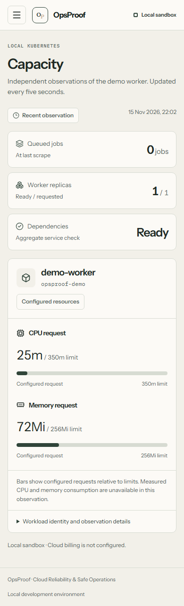

# Public evidence

## Local results and screenshots

The local Kubernetes benchmark ran three accepted trials per scaling mode against
the same application revision and load script. A trial submitted 60 jobs configured for 2 seconds of
work each, with 120 seconds of background HTTP load. The generator targeted
80 requests/s and served roughly 48-63 requests/s across accepted trials.
The HPA scaled the API. KEDA scaled workers using Redis Streams lag and pending
entries. The comparison takes the median of the three p95s in each mode.
The Grafana and Argo CD UI servers were paused during all accepted trials.

| Mode | Trial | Job completion p95 (s) | Throughput (jobs/s) | Background HTTP p95 (ms) |
| --- | ---: | ---: | ---: | ---: |
| Fixed replicas | 1 | 101.433886 | 0.498091 | 202.85 |
| Fixed replicas | 2 | 101.500207 | 0.497703 | 207.57 |
| Fixed replicas | 3 | 101.311598 | 0.497013 | 256.50 |
| API HPA | 1 | 101.623977 | 0.497294 | 211.81 |
| API HPA | 2 | 102.359241 | 0.497389 | 201.04 |
| API HPA | 3 | 102.265894 | 0.497926 | 204.86 |
| KEDA worker scaling | 1 | 34.481898 | 1.237319 | 202.30 |
| KEDA worker scaling | 2 | 35.423098 | 1.224233 | 194.72 |
| KEDA worker scaling | 3 | 37.208533 | 1.219666 | 198.18 |

- **Job p95 reduction** equals `(101.433886 - 35.423098) / 101.433886 * 100 = 65.08%`.
- **Job p95 time saved** equals `101.433886 - 35.423098 = 66.01 s`.
- **Median throughput** was `1.224233 / 0.497703 = 2.46` times the fixed-replica baseline.

Each accepted trial completed all 60 exact jobs once. Two excluded attempts
remain in the private run history. One was indeterminate before restoration
finished and one recorded an HTTP failure. Background rates varied. These
measurements cover the controlled local environment. AWS performance remains
unmeasured.

The table uses the retained analyzer output. It records application revision
`093b7aebebff51363fdd2527987b25059a43b971` and load script SHA-256
`72ef5415449ef1dbfe1014b715981f423fdec91a417ad952cfff3abf3e754c30`.
The [analysis code](../../scripts/reliability/analyze_capacity.py) validates
exact job IDs, comparable workloads and source identities before computing
medians from the original receipts.

### Recovery and UI evidence

A separate k6 run reconciled **60 unique submissions and 60 durable
completions**. The [six sanitized scenario records](cases.json)
cover database connectivity, downstream timeout, canary abort, worker
interruption, queue saturation and stale observations. They include source
identities and independent evidence digests. A separate shutdown drill
recorded eight exact job completions and verification resuming after restart.

[View the recovery approval and verified outcome](screenshots/local-recovery.png).
Both images are original captures from the local Kubernetes deployment. The
deployment receipt records Argo CD `Synced` and `Healthy`, 34 served assets
matched by hash and 20 passing view and viewport checks.

## Curated scenario data

`cases.json` contains one sanitized historical local trial for each of the six
scenario classes. GitHub Pages publication requires separate approval.
It records actual independent receipt digests, tested source-tree hashes and
uncommitted-source status. It makes no current-cloud or AI qualification claim.
Private source bindings remain in ignored runtime storage; raw trial artifacts,
keys, account information and live operator URLs are excluded.

Before publication, rerun `scripts.cloud.verify_curated_evidence` with the
private bindings, render the site, run `verify_public_replay`, inspect it visually
and have the owner review privacy and claims. The Pages workflow requires the
exact reviewed JSON hash at the approved main commit and a protected deployment.
Automated lineage and sanitizer checks do not replace that review.
